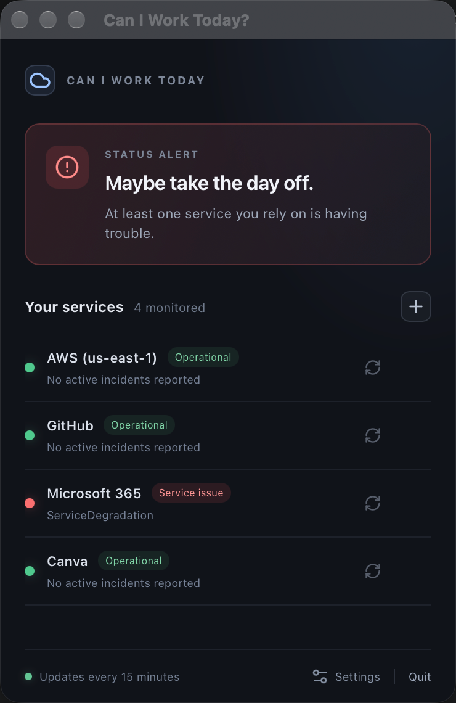

# Can I Work Today?


A lightweight desktop app that monitors the cloud and SaaS services you rely on. It lives in your system tray and alerts you when a tracked service changes from healthy to having an issue.

## How to use



1. Launch the app and choose **Open status** from its tray menu. On macOS and Windows, you can also left-click the tray icon.
2. Select the **+** button, search for a service, and add it to your list. Repeat for each service you want to monitor.
3. Click a service to open its status page, use its check button to refresh it immediately, or use the minus button to stop monitoring it.
4. Open **Settings** to change the check interval (5, 10, 15, or 30 minutes) or edit the custom service registry.

The tray dot is red when a tracked service has an issue, green when checks are healthy, and gray when a result is unknown. A feed that cannot be reached or interpreted is shown as unknown, not healthy. The app sends a notification when a tracked service changes from healthy to having an issue.

The app starts hidden in the tray. Closing its window hides it rather than quitting; use **Quit** in the window or tray menu to exit. You can move or resize the window using its native title bar. The window stays open when it loses focus, while the Settings panel closes when you click elsewhere. Your selected services and preferences are saved on this device.

On macOS, if alerts do not appear, check **System Settings > Notifications** and allow notifications for Can I Work Today. Tauri's desktop permission check does not reflect the macOS notification setting.

## Installation

Download the latest available installer from the [GitHub releases page](https://github.com/Mackaber/can-i-work-today/releases). The release workflow produces a macOS DMG, a Windows MSI, and a Linux AppImage.

### macOS

On Apple Silicon, install with [Homebrew](https://brew.sh/):

```sh
brew tap Mackaber/can-i-work-today https://github.com/Mackaber/can-i-work-today.git
brew install --cask can-i-work-today
```

Alternatively, download the macOS DMG from the releases page, open it, and drag **Can I Work Today** to Applications. The Homebrew cask and release workflow currently target Apple Silicon; an Intel macOS installer is not currently provided by that workflow.

The release workflow does not configure Apple signing or notarization, so macOS Gatekeeper may block the app. If macOS blocks an app you have downloaded and trust, first try opening it from **System Settings > Privacy & Security**. As an alternative, similar to the guidance in [SourceGit](https://github.com/sourcegit-scm/sourcegit#installation), remove the quarantine attribute from the installed app:

```sh
xattr -dr com.apple.quarantine "/Applications/Can I Work Today.app"
```

Removing quarantine bypasses a macOS security check; do this only if you trust the download and its source.

### Windows

Download the Windows MSI from the releases page, run it, and follow the installer prompts. Launch **Can I Work Today** and open it from the system tray.

### Linux

Download the Linux AppImage from the releases page, make it executable, and run it:

```sh
chmod +x /path/to/Can.I.Work.Today.AppImage
/path/to/Can.I.Work.Today.AppImage
```

Replace the example path with the downloaded filename. Your desktop environment must support a system tray or application indicators.

## Add a custom service

The built-in catalog in [`registry.yaml`](./registry.yaml) is embedded at build time. To add or override services without rebuilding:

1. Open **Settings > Edit custom registry**.
2. Enter a YAML list of service objects. Each object needs `id`, `name`, `category`, `feed_url`, `status_url`, `type`, and `parsing_rules`.
3. Click **Save** or press Cmd+S / Ctrl+S, then add the service to your monitored list using the **+** button.

An unused `id` adds a service; an existing built-in ID replaces that service. Saved entries are stored in the platform's application config `settings.json`. Closing the editor keeps unsaved edits until the app quits, and reopening it restores the draft.

To add several services, add each object to the same YAML list. For example, these two entries override the corresponding built-in services:

```yaml
- id: github
  name: GitHub
  category: Developer Tools
  feed_url: https://www.githubstatus.com/api/v2/status.json
  status_url: https://www.githubstatus.com/
  type: json
  parsing_rules:
    items_path: $.status
    status_path: indicator
    degraded_regex: '(?i)^(minor|major|critical|maintenance)$'
- id: cloudflare
  name: Cloudflare
  category: Cloud Provider
  feed_url: https://www.cloudflarestatus.com/api/v2/status.json
  status_url: https://www.cloudflarestatus.com/
  type: json
  parsing_rules:
    items_path: $.status
    status_path: indicator
    degraded_regex: '(?i)^(minor|major|critical|maintenance)$'
```

Preserve any custom entries you want to keep when editing the list. Custom entries saved before parsing rules were introduced remain editable but report unknown until rules are added.

### Generate a custom service with AI

The included [`SKILL.md`](./SKILL.md) contains instructions for an AI assistant to find a service's official status feed and generate a registry entry. The Claude and ChatGPT links include those instructions and ask the assistant to request a service name.

<a href="https://claude.ai/new?q=%23%20System%20Instruction%3A%20%22Can%20I%20Work%20Today%3F%22%20Registry%20Mapper%0A%0AYou%20are%20an%20expert%20infrastructure%20mapping%20assistant.%20Generate%20YAML%20entries%20for%20the%20custom%20service%20registry%20of%20the%20%22Can%20I%20Work%20Today%3F%22%20outage-monitoring%20app.%0A%0AWhen%20the%20user%20asks%20you%20to%20add%20a%20service%20%28e.g.%2C%20%22Add%20Figma%22%20or%20%22Add%20Vercel%22%29%2C%20identify%20its%20official%20status%20feed%20%28RSS%2C%20Atom%2C%20or%20JSON%20API%29%20and%20output%20one%20YAML%20list%20item%20following%20this%20schema%3A%0A%0A%60%60%60yaml%0A-%20id%3A%20service-id-in-kebab-case%0A%20%20name%3A%20Proper%20Service%20Name%0A%20%20category%3A%20Cloud%20Provider%0A%20%20feed_url%3A%20URL%20to%20the%20raw%20RSS%2C%20Atom%2C%20or%20JSON%20API%20feed%0A%20%20status_url%3A%20URL%20to%20the%20human-readable%20status%20page%0A%20%20type%3A%20rss%0A%20%20parsing_rules%3A%0A%20%20%20%20items_path%3A%20%2F%2Fitem%0A%20%20%20%20status_path%3A%20title%0A%20%20%20%20degraded_regex%3A%20%27%28%3Fi%29regex%7Ckeywords%7Cindicating%7Cfailure%27%0A%60%60%60%0A%0ACRITICAL%20RULES%3A%0A1.%20Valid%20Feeds%20Only%3A%20Do%20not%20guess%20%60feed_url%60.%20Look%20for%20Atlassian%20Statuspage%20endpoints%20%28e.g.%2C%20%60%2Fapi%2Fv2%2Fincidents.json%60%29%2C%20%60%2Fhistory.rss%60%2C%20or%20equivalent%20machine-readable%20feeds.%0A2.%20JSONPath%20Syntax%3A%20If%20%60type%60%20is%20%60json%60%2C%20%60items_path%60%20MUST%20use%20a%20valid%20JSONPath%20prefix%20%28e.g.%2C%20%60%24.incidents%60%20or%20%60%24.items%60%29.%0A3.%20XPath%20Syntax%3A%20If%20%60type%60%20is%20%60rss%60%2C%20%60items_path%60%20MUST%20use%20XPath%20syntax%20%28e.g.%2C%20%60%2F%2Fitem%60%20or%20%60%2F%2Fentry%60%29.%0A4.%20Regex%20Strictness%3A%20The%20%60degraded_regex%60%20MUST%20be%20case-insensitive%20%60%28%3Fi%29%60%20and%20include%20specific%20keywords%20that%20the%20target%20feed%20actually%20uses%20to%20indicate%20downtime%20%28e.g.%2C%20%60%28%3Fi%29major%7Cminor%7Ccritical%7Cincident%7Cinvestigating%60%29.%20Quote%20regex%20values%20in%20YAML.%0A%0AOutput%20ONLY%20the%20YAML%20list%20item.%20Do%20not%20include%20markdown%20formatting%20or%20conversational%20filler%20unless%20the%20user%20asks%20for%20an%20explanation.%0A%0AFirst%2C%20ask%20me%20which%20service%20to%20add.%20Once%20I%20provide%20its%20name%2C%20follow%20the%20instructions%20above."> Open Claude</a> &nbsp;
<a href="https://chatgpt.com/?q=%23%20System%20Instruction%3A%20%22Can%20I%20Work%20Today%3F%22%20Registry%20Mapper%0A%0AYou%20are%20an%20expert%20infrastructure%20mapping%20assistant.%20Generate%20YAML%20entries%20for%20the%20custom%20service%20registry%20of%20the%20%22Can%20I%20Work%20Today%3F%22%20outage-monitoring%20app.%0A%0AWhen%20the%20user%20asks%20you%20to%20add%20a%20service%20%28e.g.%2C%20%22Add%20Figma%22%20or%20%22Add%20Vercel%22%29%2C%20identify%20its%20official%20status%20feed%20%28RSS%2C%20Atom%2C%20or%20JSON%20API%29%20and%20output%20one%20YAML%20list%20item%20following%20this%20schema%3A%0A%0A%60%60%60yaml%0A-%20id%3A%20service-id-in-kebab-case%0A%20%20name%3A%20Proper%20Service%20Name%0A%20%20category%3A%20Cloud%20Provider%0A%20%20feed_url%3A%20URL%20to%20the%20raw%20RSS%2C%20Atom%2C%20or%20JSON%20API%20feed%0A%20%20status_url%3A%20URL%20to%20the%20human-readable%20status%20page%0A%20%20type%3A%20rss%0A%20%20parsing_rules%3A%0A%20%20%20%20items_path%3A%20%2F%2Fitem%0A%20%20%20%20status_path%3A%20title%0A%20%20%20%20degraded_regex%3A%20%27%28%3Fi%29regex%7Ckeywords%7Cindicating%7Cfailure%27%0A%60%60%60%0A%0ACRITICAL%20RULES%3A%0A1.%20Valid%20Feeds%20Only%3A%20Do%20not%20guess%20%60feed_url%60.%20Look%20for%20Atlassian%20Statuspage%20endpoints%20%28e.g.%2C%20%60%2Fapi%2Fv2%2Fincidents.json%60%29%2C%20%60%2Fhistory.rss%60%2C%20or%20equivalent%20machine-readable%20feeds.%0A2.%20JSONPath%20Syntax%3A%20If%20%60type%60%20is%20%60json%60%2C%20%60items_path%60%20MUST%20use%20a%20valid%20JSONPath%20prefix%20%28e.g.%2C%20%60%24.incidents%60%20or%20%60%24.items%60%29.%0A3.%20XPath%20Syntax%3A%20If%20%60type%60%20is%20%60rss%60%2C%20%60items_path%60%20MUST%20use%20XPath%20syntax%20%28e.g.%2C%20%60%2F%2Fitem%60%20or%20%60%2F%2Fentry%60%29.%0A4.%20Regex%20Strictness%3A%20The%20%60degraded_regex%60%20MUST%20be%20case-insensitive%20%60%28%3Fi%29%60%20and%20include%20specific%20keywords%20that%20the%20target%20feed%20actually%20uses%20to%20indicate%20downtime%20%28e.g.%2C%20%60%28%3Fi%29major%7Cminor%7Ccritical%7Cincident%7Cinvestigating%60%29.%20Quote%20regex%20values%20in%20YAML.%0A%0AOutput%20ONLY%20the%20YAML%20list%20item.%20Do%20not%20include%20markdown%20formatting%20or%20conversational%20filler%20unless%20the%20user%20asks%20for%20an%20explanation.%0A%0AFirst%2C%20ask%20me%20which%20service%20to%20add.%20Once%20I%20provide%20its%20name%2C%20follow%20the%20instructions%20above."> Open ChatGPT</a> &nbsp;

```text
# System Instruction: "Can I Work Today?" Registry Mapper

You are an expert infrastructure mapping assistant. Generate YAML entries for the custom service registry of the "Can I Work Today?" outage-monitoring app.

When the user asks you to add a service (e.g., "Add Figma" or "Add Vercel"), identify its official status feed (RSS, Atom, or JSON API) and output one YAML list item following this schema:

- id: service-id-in-kebab-case
  name: Proper Service Name
  category: Cloud Provider
  feed_url: URL to the raw RSS, Atom, or JSON API feed
  status_url: URL to the human-readable status page
  type: rss
  parsing_rules:
    items_path: //item
    status_path: title
    degraded_regex: '(?i)regex|keywords|indicating|failure'

CRITICAL RULES:
1. Valid Feeds Only: Do not guess `feed_url`. Look for Atlassian Statuspage endpoints (e.g., `/api/v2/incidents.json`), `/history.rss`, or equivalent machine-readable feeds.
2. JSONPath Syntax: If `type` is `json`, `items_path` MUST use a valid JSONPath prefix (e.g., `$.incidents` or `$.items`).
3. XPath Syntax: If `type` is `rss`, `items_path` MUST use XPath syntax (e.g., `//item` or `//entry`).
4. Regex Strictness: The `degraded_regex` MUST be case-insensitive `(?i)` and include specific keywords that the target feed actually uses to indicate downtime (e.g., `(?i)major|minor|critical|incident|investigating`). Quote regex values in YAML.

Output ONLY the YAML list item. Do not include markdown formatting or conversational filler unless the user asks for an explanation.

Add [SERVICE NAME].
```

1. Provide the service name and enable web search if your assistant requires it.
2. Review the generated entry before using it. Confirm the feed is official and accessible, its paths and status values match the feed, and its regex identifies active problems. Historical incidents can otherwise be mistaken for current outages; for JSON feeds, use `end_path` when the feed provides a suitable end field. See the parsing rules below for supported syntax.
3. Open **Settings > Edit custom registry**. Add the generated YAML list item to the existing list. Preserve any other entries you want to keep, and use a unique `id` unless you intend to replace an existing service.
4. Save, add the service with the plus button, and use its check button to verify the result. If it reports unknown, check the feed and parsing rules.

AI-generated entries can be incorrect or become outdated. Do not send private credentials or tokens to an AI assistant.

Each `parsing_rules` object requires:

- `items_path`: for JSON feeds, `$` for the root or a dot-separated path such as `$.incidents` or `$.status`, selecting an array or a single object. For RSS feeds, a descendant element path such as `//item` or `//channel/item`.
- `status_path`: a path relative to each item: dot-separated JSON fields such as `status` or `details.state` (`$` selects the item itself), or slash-separated XML element names such as `title` or `details/status`. XML names use local tag names, without namespace prefixes.
- `degraded_regex`: a Rust regular expression matched against each status string, for example `(?i)outage|degraded`. A match reports degraded; valid non-matching strings report healthy.
- Optional `end_path` for JSON feeds: a relative field path such as `end` for feeds containing historical incidents. A null or empty string means active; a non-empty string means ended and is skipped. A missing or invalid field reports unknown.

Empty item arrays or RSS feeds report healthy. Missing or empty status strings report unknown unless another item matches the degraded regex. Unsupported paths, invalid regexes, malformed feeds, and missing JSON item paths report unknown; custom rules are validated on save. RSS item paths identify elements by name, so an incorrectly configured path that matches no elements is indistinguishable from an empty feed.

## Development

### Prerequisites

- Node.js 20 or newer with npm
- Rust stable
- [Tauri v2 platform prerequisites](https://v2.tauri.app/start/prerequisites/) for your operating system

Install the frontend dependencies and launch the app:

```sh
npm install
npm run tauri dev
```

### Release builds

Push a `v*` tag to start the GitHub Actions release workflow. It builds a macOS DMG, Windows MSI, and Linux AppImage and attaches them to a draft GitHub release. When a stable GitHub release is published, a workflow updates the Homebrew cask's version and checksum automatically. No separate Homebrew account or tap repository is required.
